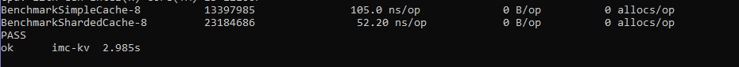

Sharded In-Memory Key-Value Cache on Go

• Горизонтальное шардирование (32 сегмента) для минимизации Lock Contention.
• Потокобезопасный конкурентный CRUD (sync.RWMutex, RLock для быстрого параллельного чтения).
• Активный фоновый сборщик мусора на каждый шард через time.Ticker и каналы.
• Пассивное удаление просроченных элементов при вызове Get.
Результаты бенчмарков:

Шардирование позволило увеличить производительность в 2 раза под высокой параллельной нагрузкой.